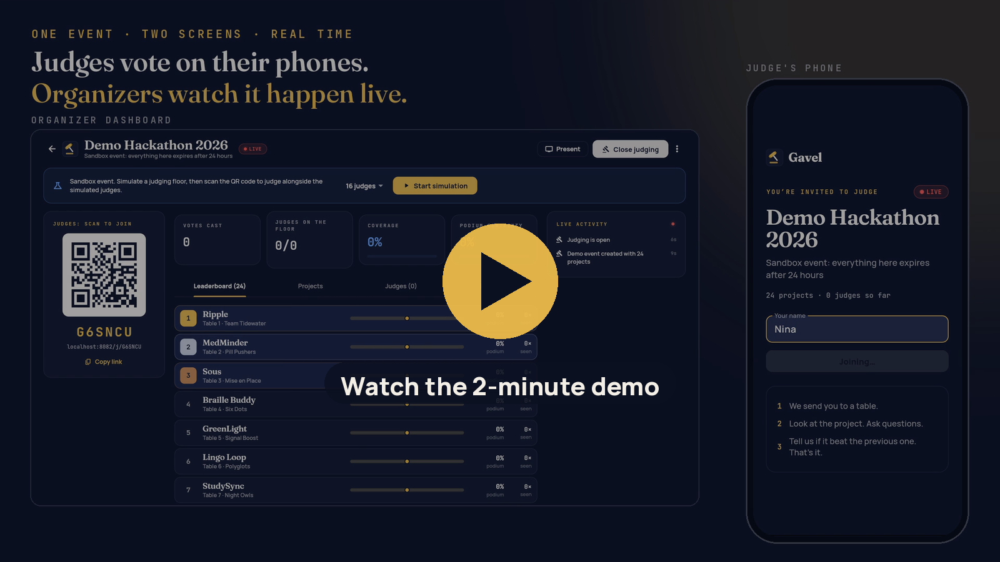
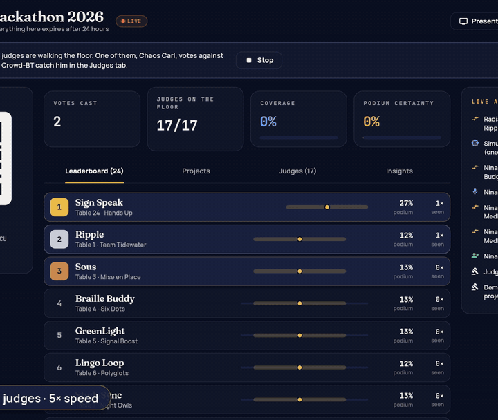
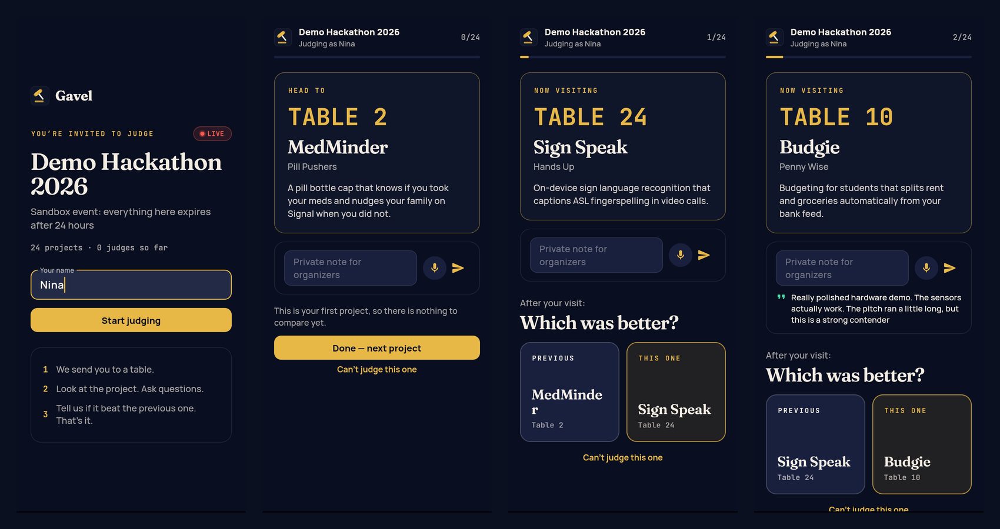
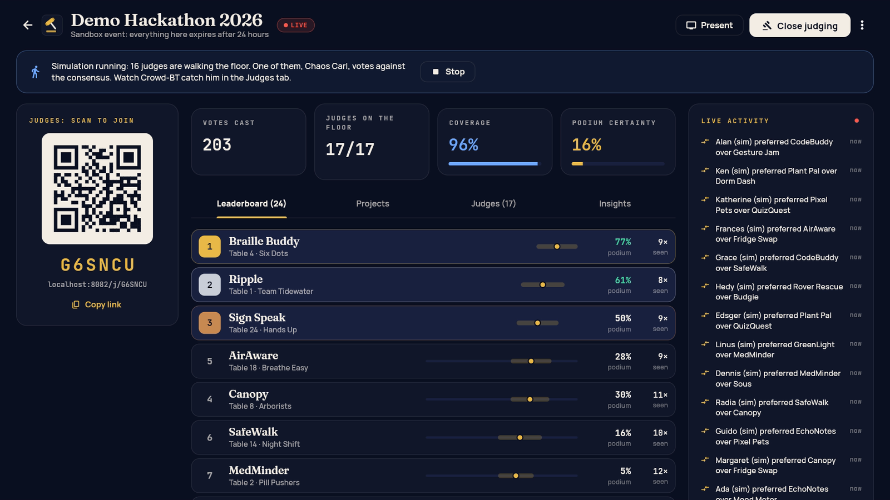
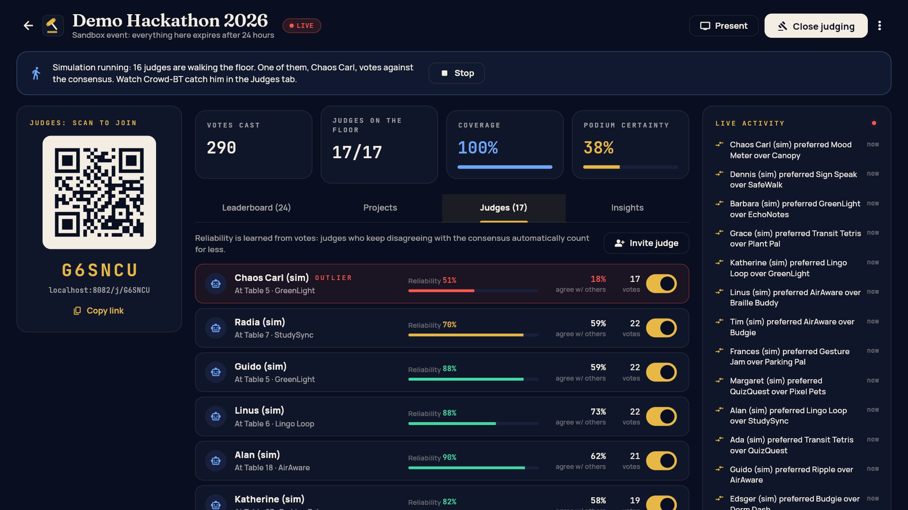
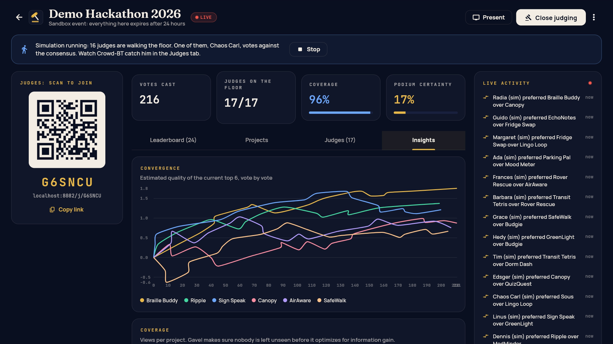
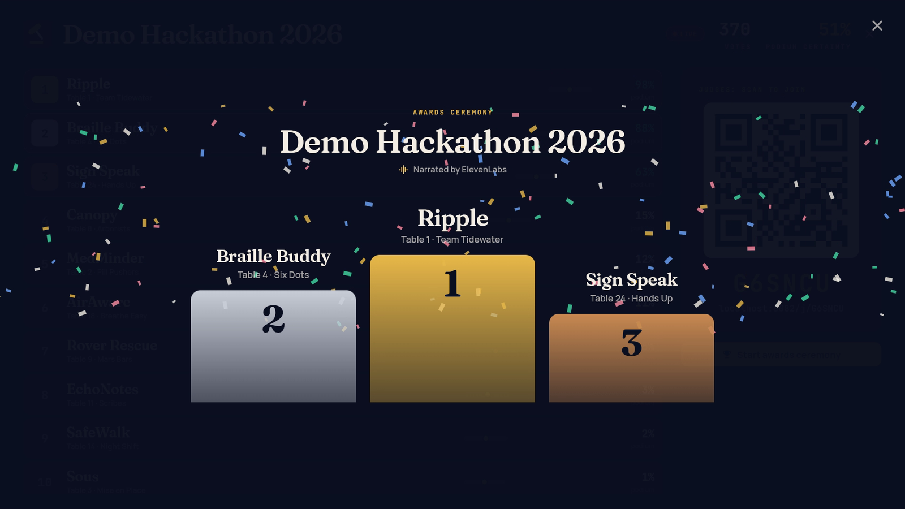
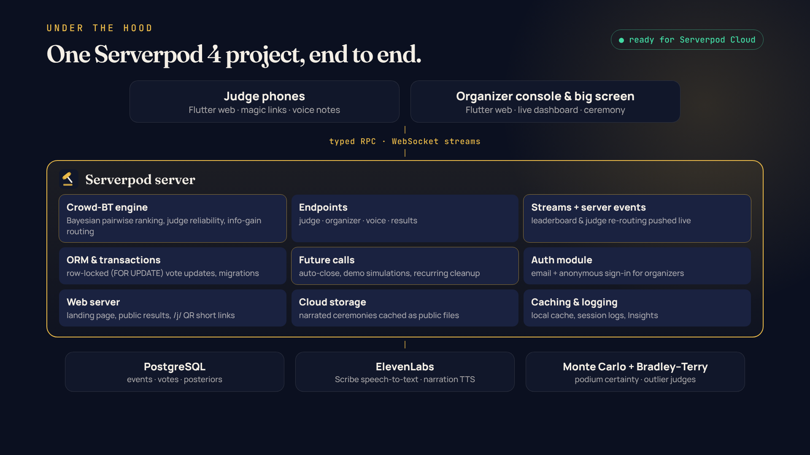
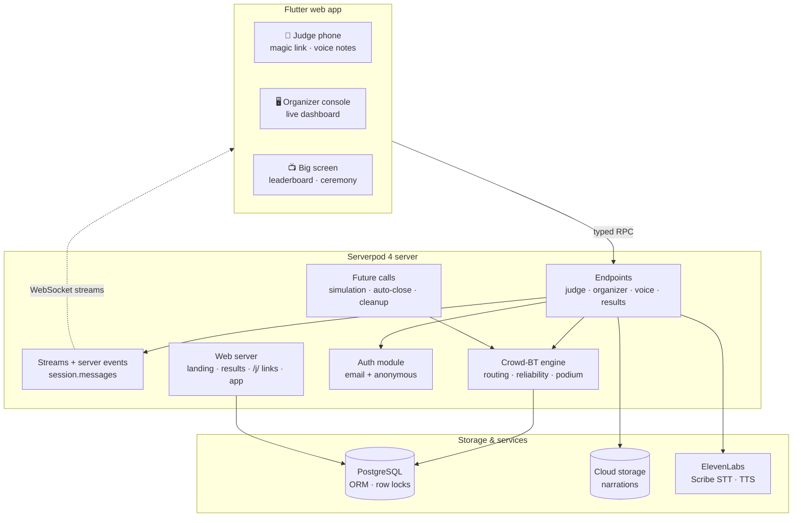
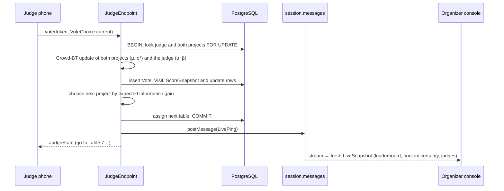

<div align="center">


# Gavel

**Fair, live hackathon judging. Better or worse? That's the whole rubric.**

[](docs/media/gavel-demo.mp4)

**[▶ Watch the demo video (1:51)](docs/media/gavel-demo.mp4)** · Built with **Serverpod 4** + Flutter · Voice by **ElevenLabs**

</div>

---

## What is Gavel?

Gavel replaces 1–10 rubric scores with **pairwise comparisons**. Judges scan a QR code, get sent to a table, and answer one question on their phone: *was this project better than the last one?*
A Bayesian **Crowd-BT** ranking engine running on Serverpod decides where every judge should walk next, learns which judges to trust, and **streams a live, statistically honest leaderboard** to organizers.
At the end, one click runs the awards ceremony on the big screen, **narrated by ElevenLabs**.

<p align="center"></p>

---

## The problem

Every hackathon ends the same way: hundreds of projects, a dozen tired judges, two hours, and a spreadsheet of scores nobody trusts.

- **Scores are uncalibrated.** One judge's 7 is another judge's 9. A team's rank depends on which judge they happened to draw.
- **Coverage is random.** Hand-made spreadsheets send three judges to one table and none to another. Absent teams waste judges' time.
- **Bad judges are invisible.** A judge who is tired, distracted, or biased counts exactly as much as everyone else.
- **Nobody knows when to stop.** Organizers can't tell whether the top 3 is settled or a coin flip, and tallying happens by hand at the end.

## Our solution

| | |
|---|---|
| 🤝 **Compare, don't score** | After each table the judge answers one question: better or worse than the previous project? People are inconsistent with absolute scales but consistent at comparisons, and comparisons cancel out judge bias. |
| 🧠 **Crowd-BT engine** | Every vote updates a Bayesian posterior over each project's quality *and* each judge's reliability (Beta prior). Unreliable judges are down-weighted automatically. |
| 🧭 **Smart routing** | The next table is picked by **expected information gain**, with ε-greedy exploration, a minimum number of views per project, prioritized tables, and no two judges at the same table. |
| 🎯 **Podium certainty** | Monte Carlo sampling over the posteriors estimates the probability that the current top 3 is the true top 3, so organizers know when they can stop judging. |
| 🚩 **Outlier judges** | A leave-one-out Bradley–Terry fit measures how often each judge agrees with *everyone else*. In the demo, "Chaos Carl" agrees only 19% of the time and gets flagged. |
| ⚡ **Live everything** | Votes, joins, skips and the leaderboard stream to the organizer console over WebSockets. Pause a project and judges walking there are re-routed instantly. |
| 🎙️ **Voice with ElevenLabs** | Judges dictate notes (transcribed server-side with **ElevenLabs Scribe**), and the awards ceremony is narrated with **ElevenLabs TTS**. |
| 🧪 **60-second sandbox** | "Try the demo" creates a 24-project event. One click starts 16 simulated judges (including a contrarian), and you can scan the QR code to judge alongside them. |

<p align="center">
  
</p>

| Organizer console | Judge reliability & outliers |
|---|---|
|  |  |
| **Convergence & coverage** | **Big screen + ElevenLabs-narrated ceremony** |
|  |  |

---

## How we use Serverpod

Gavel is a single Serverpod 4 workspace (`gavel_server`, generated `gavel_client`, `gavel_flutter`). Nearly every Serverpod feature has a job:

| Serverpod feature | What Gavel does with it | Where |
|---|---|---|
| **Typed endpoints** | `organizer`, `judge`, `voice` and `results` endpoints. The Flutter app calls them as plain Dart methods (`client.judge.vote(token, VoteChoice.current)`), with no REST glue. | [`lib/src/endpoints/`](gavel_server/lib/src/endpoints) |
| **Streaming methods + server events** | `organizer.watch(eventId)` streams throttled `LiveSnapshot`s, fed by `session.messages.postMessage` pings after every vote, join and skip. `judge.watch(token)` pushes re-routing to phones. | [`live_service.dart`](gavel_server/lib/src/services/live_service.dart), [`judge_endpoint.dart`](gavel_server/lib/src/endpoints/judge_endpoint.dart) |
| **Models, relations & ORM** | 9 tables (events, organizers, projects, judges, votes, visits, notes, score snapshots, activity) with foreign keys, cascades, unique and composite indexes, enums, DTOs and a serializable `GavelException`. | [`lib/src/models/`](gavel_server/lib/src/models) |
| **Transactions + row locking** | Each vote locks both projects and the judge with `LockMode.forUpdate`, in a stable order so concurrent votes never deadlock, before applying the Bayesian update. | [`judging_service.dart`](gavel_server/lib/src/services/judging_service.dart) |
| **Migrations** | Schema versioned with `serverpod create-migration` and applied on start (`--apply-migrations`). | [`migrations/`](gavel_server/migrations) |
| **Future calls** | `SimulationFutureCall` re-schedules itself to drive the simulated judges. `EventCloseFutureCall` closes judging at a scheduled time (`callAtTime` with an identifier, cancellable, survives restarts). `MaintenanceFutureCall` runs every 30 min via `callRecurring` and expires demo sandboxes. | [`lib/src/future_calls/`](gavel_server/lib/src/future_calls) |
| **Auth module** | Organizers sign in with email (Serverpod Cloud email service) or **anonymously**, for zero-friction demos. Organizer endpoints use `requireLogin`, and co-organizers join through an admin link. Judges never need an account: they use secret magic-link tokens. | [`server.dart`](gavel_server/lib/server.dart), [`access.dart`](gavel_server/lib/src/services/access.dart) |
| **Cloud storage** | The ElevenLabs ceremony narration is stored in `public` storage (`ServerpodCloudProvider`, database fallback locally) and cached by script hash. | [`announcement_service.dart`](gavel_server/lib/src/services/announcement_service.dart) |
| **Web server (Relic)** | A server-rendered landing page (`WidgetRoute` + Mustache template + cache busting, live DB stats) and public results pages (`/results/<slug>`). `/j/<code>` QR short links redirect into the app, and the Flutter web app is served by `FlutterRoute` with a dynamic `config.json`. | [`lib/src/web/`](gavel_server/lib/src/web), [`web/templates/`](gavel_server/web/templates) |
| **Caching** | Landing-page stats go through `session.caches.local` with a `CacheMissHandler`. | [`landing_route.dart`](gavel_server/lib/src/web/routes/landing_route.dart) |
| **Passwords / secrets** | The ElevenLabs API key lives in Serverpod's password store and never reaches the app. | [`elevenlabs.dart`](gavel_server/lib/src/services/elevenlabs.dart) |
| **Logging** | `session.log` for failed narrations and transcriptions; session logs are visible in Insights. | — |
| **Testing tools** | `withServerpod` integration tests cover the real judging flow against Postgres (join, vote, skip, auto-pause, access control, publishing), alongside unit tests for the math. 19 tests in total. | [`test/`](gavel_server/test) |
| **Serverpod Cloud** | `scloud.yaml` with `pre_deploy` hooks (`serverpod generate`, `serverpod run flutter_build`) and `.scloudignore` that ships the built web app. | [`scloud.yaml`](gavel_server/scloud.yaml) |

### Architecture

<p align="center"></p>



### What happens when a judge votes



---

## The ranking model (in one minute)

- **Crowd-BT** (Chen et al., WSDM 2013): judge *k* reports the true order of projects *i*, *j* with probability η<sub>k</sub> ~ Beta(α<sub>k</sub>, β<sub>k</sub>), otherwise the reverse. Project quality *s*<sub>i</sub> has a Gaussian posterior N(μ<sub>i</sub>, σ²<sub>i</sub>). Every vote is an online moment-matching update of all three posteriors ([`crowd_bt.dart`](gavel_server/lib/src/ranking/crowd_bt.dart), with our own log-gamma and digamma in pure Dart).
- **Routing**: among valid tables (not seen, not busy, minimum views first, prioritized first), pick the one maximizing expected KL information gain against the judge's previous project, with ε = 0.25 exploration.
- **Podium certainty**: 2,000 Monte Carlo draws from the posteriors ([`podium.dart`](gavel_server/lib/src/ranking/podium.dart)).
- **Outliers**: Hunter's MM algorithm fits Bradley–Terry strengths on everyone else's votes, and we check each judge against that fit ([`bradley_terry.dart`](gavel_server/lib/src/ranking/bradley_terry.dart)).
- A unit test simulates an expo with a contrarian judge and asserts the ranking tracks the ground truth (Spearman > 0.7) and the contrarian ends up least trusted.

---

## Run it locally

Prerequisites: **Flutter 3.44.4+** and the **Serverpod CLI 4.0.4** (`dart install serverpod_cli`). New projects use Serverpod's embedded PostgreSQL, so you don't need to run a separate database.

```bash
git clone https://github.com/chinesepowered/hack-sp-gavel.git
cd hack-sp-gavel && flutter pub get
cd gavel_server
cp config/passwords.example.yaml config/passwords.yaml   # local dev secrets
# optional: uncomment elevenLabsApiKey in config/passwords.yaml for voice features
serverpod run flutter_build    # builds the Flutter web app that the server hosts at /app
serverpod start                # embedded Postgres + migrations + server (+ dev app)
```

Then:

1. Open **http://localhost:8082/** for the landing page, then click **Try the 60-second demo**.
2. Click **Start simulation** to watch 16 simulated judges, or scan the QR code on your phone and join them.
3. Open **Present** and start the **awards ceremony** when you're done.

Without an ElevenLabs key everything still works: the mic button is hidden and the ceremony reveals the podium on a timer.

**Tests:** `cd gavel_server && dart test` runs 9 unit and 10 integration tests (`withServerpod` starts its own test database).

**Deploy to Serverpod Cloud:**

```bash
cd gavel_server
serverpod cloud launch                               # or: scloud project create <id> --enable-db
serverpod cloud password set elevenLabsApiKey <key>
serverpod cloud variable set SERVERPOD_MAX_REQUEST_SIZE 2097152        # voice notes
serverpod cloud variable set SERVERPOD_FUTURE_CALL_SCAN_INTERVAL 1000  # simulation ticks
serverpod cloud deploy                               # pre-deploy hooks build the Flutter web app
```

## Project layout

```
gavel_server/
  lib/src/endpoints/     organizer, judge, voice, results endpoints
  lib/src/models/        .spy.yaml tables, enums, DTOs, exception
  lib/src/ranking/       Crowd-BT, podium Monte Carlo, Bradley–Terry
  lib/src/services/      judging flow, live snapshots, simulation, ElevenLabs
  lib/src/future_calls/  simulation ticks, scheduled close, recurring cleanup
  lib/src/web/           landing page, results page, QR short links
  web/                   templates, static assets, built Flutter app
  test/                  unit + withServerpod integration tests
gavel_flutter/lib/
  screens/judge/         join, judging flow, voice notes
  screens/organizer/     events, live dashboard, present mode & ceremony
  widgets/               animated leaderboard, judges, insights, QR card
gavel_client/            generated by Serverpod
```

## Credits

- Pairwise expo judging was popularized at hackathons by Anish Athalye's Gavel (Python). This project is an independent reimplementation in Dart, Flutter and Serverpod, with live streaming, outlier detection, podium certainty, voice notes and simulations added. The underlying model is from *Pairwise Ranking Aggregation in a Crowdsourced Setting* (Chen, Bennett, Collins-Thompson & Horvitz, 2013).
- Voice: ElevenLabs Scribe (speech-to-text) and Multilingual v2 (narration). The demo video's narration and music were also generated with ElevenLabs.
- Built for Serverpod's **"Build Something Real"** hackathon using Serverpod 4's agentic workflow (Claude Code with Serverpod's agent skills).
